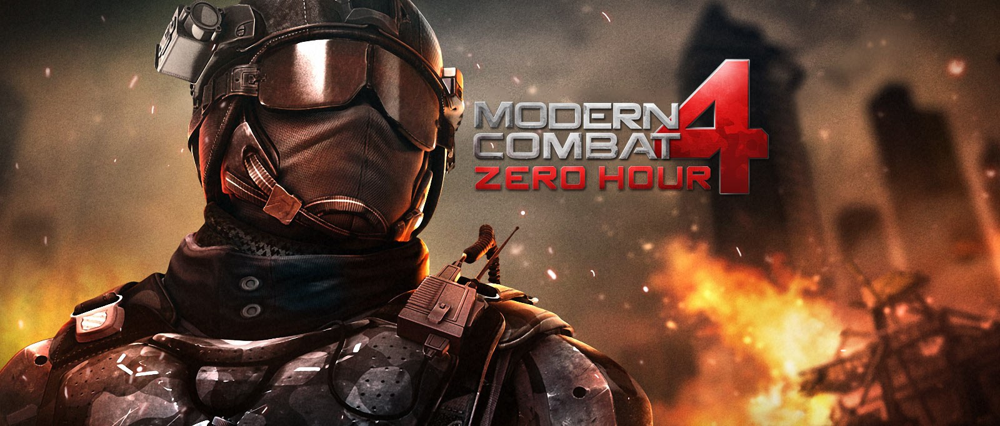

<div align=center>



</div>
<h1 align=center>mc4_nx — Modern Combat 4: Zero Hour for Nintendo Switch</h1>

An **unofficial** native Nintendo Switch port of the **32-bit Android (armeabi-v7a) release of Modern Combat 4:
Fallen Nation 1.1.7g**.

It is not an emulator. The game's own ARM library runs natively on the Switch's CPU as a 32-bit (AArch32) Horizon
program, on the [android32](https://github.com/aks796/android32) runtime: a `.so` loader with the parts of Android,
Java (JNI) and OpenGL ES the game calls, answered by this port. Graphics are Mesa's nouveau driver.

**No game code or assets are included**, here or in the releases. You need your own copy of the game.

> [!IMPORTANT]
> **Version 1.0.0 — playable.** Tested on hardware through the first missions of the campaign: menus, gameplay,
> sound, the Gameloft logo and the mission briefing videos, the pause / mission failed / debriefing screens, sleep
> and HOME. 60 FPS target, 720p handheld / 1080p docked. Latest version: see [Releases](../../releases).

## Known issues

- **Heavy breathing after a long sprint can go on** until the next death or loading screen. The port releases the
  sprint key every time (`debug.log` shows it); the game keeps its "out of breath" state. Not yet known whether the
  Android game does the same.
- **Multiplayer does not work**: Gameloft's servers are gone (the same on Android).
- **A does nothing during play itself** (it does in every menu): the PS Vita port found that the Xperia "select" key
  triggers an engine bug there. In-game prompts (doors, pick-ups) are the game's on-screen buttons: use the touch
  screen in handheld.

## What you need

- A Switch running **Atmosphère** (custom firmware) that can run 32-bit homebrew (current android32 ports:
  "Updated for FW 21+").
- **[sphaira](https://github.com/ITotalJustice/sphaira)**, to make a HOME-menu forwarder: the game is a 32-bit
  program and only runs from its own HOME-menu icon, not from the homebrew menu.
- **Your own copy** of Modern Combat 4 **1.1.7g** for Android (`com.gameloft.android.ANMP.GloftM4HM`):
  - the **APK** (any file name), whose `lib/armeabi-v7a/libModernCombat4.so` has SHA-1
    `be0d5e8779899e081a538b3930ec711d2df8aeb4`;
  - its two **OBB** files, from `/sdcard/Android/obb/com.gameloft.android.ANMP.GloftM4HM/` on the phone:
    `main.1120.com.gameloft.android.ANMP.GloftM4HM.obb` and `patch.11428.com.gameloft.android.ANMP.GloftM4HM.obb`.

## Install

1. Download `mc4_nx.nro` from the [Releases](../../releases) page (or [build it](#build-from-source)).
2. Copy it and your game files to the SD card like this:

   ```text
   sdmc:/switch/mc4_nx/
   ├── mc4_nx.nro
   ├── mc4.apk                (your APK; any name works)
   └── obb/
       ├── main.1120.com.gameloft.android.ANMP.GloftM4HM.obb
       └── patch.11428.com.gameloft.android.ANMP.GloftM4HM.obb
   ```

   The OBBs stay as they are: do not extract them.
3. In sphaira: **Homebrew → Modern Combat 4 → Install Forwarder**. Default settings are fine.
4. Start **Modern Combat 4 from its HOME-menu icon**. The first start installs the game program for that icon and
   restarts it, then unpacks the game library from the APK and the briefing videos from the patch OBB (a green
   progress bar). Later starts go straight to the game.

After the first start the folder looks like this (everything new is created by the port):

```text
sdmc:/switch/mc4_nx/
├── mc4_nx.nro
├── mc4.apk
├── obb/                       (your two OBBs, read in place)
├── libModernCombat4.so        (unpacked from the APK)
├── config.ini                 (settings, see below)
├── debug.log                  (the log of the last start: attach it to bug reports)
├── data/                      (the game's internal storage)
└── external/                  (the game's files: saves, unpacked briefing videos)
```

**Update**: replace `mc4_nx.nro` with the new one and start the game from the same HOME-menu icon; it updates
itself. Your saves and settings stay. **Uninstall**: delete the forwarder in the HOME menu and
`sdmc:/atmosphere/contents/<the forwarder's title id>/`, then the folder.

## Controls

| Button | In game | In menus |
| --- | --- | --- |
| Left stick | Move | — |
| Right stick | Look | — |
| ZR | Fire | Fire |
| ZL | Aim | Aim |
| Y | Reload | — |
| X | (Xperia "Y" button) | — |
| R | Grenade | — |
| L | Next weapon | — |
| B | Crouch | Back |
| A | — | Select |
| L3 (click) | Sprint on/off ([sprint_toggle](#configini)) | — |
| D-pad up (hold) | Sprint | Up |
| D-pad down | Crouch | Down |
| D-pad left/right | Change weapon | Left/right |
| + / − | Pause / Select | |
| Touch screen | On-screen buttons, prompts | Menus |

On every screen over gameplay (pause, mission failed, debriefing, skippable animations) A selects and B goes back:
the port reads which menu the game has on top. Videos (the Gameloft logo, the briefings): A, B, + or a tap skips.

## config.ini

Created on the first start; each line is described in the file.

| Section | Key | Default | |
| --- | --- | --- | --- |
| display | resolution | auto | 720, 1080, auto (1080 when docked at start) |
| display | frame_rate | 60 | 60 or 30 (cooler in handheld) |
| controls | look_speed | 1.0 | right stick speed, 0.3–3.0 |
| controls | sprint_toggle | true | L3 click starts sprint; another click, letting go of the left stick or aiming stops it. false: hold L3, as on Android |
| controls | invert_y | false | |
| controls | touch_screen | true | |
| performance | boost_cpu_when_loading | true | CPU at 1785 MHz while the game loads |
| debug | gl_selftest | false | graphics self-test picture at start-up |
| debug | boot_log_on_screen | false | the start-up log on screen |
| debug | trace_files | false | every opened file to debug.log (slow; bug reports) |
| debug | log_java_calls | false | every Java call to debug.log (slow; bug reports) |

## Build from source

Linux, or WSL2 on Windows, with **git** and **Docker**. Everything is compiled in containers: the AArch32 toolchain
image [`ghcr.io/vita2hos/devcontainer/vita2hos`](https://github.com/xerpi/vita2hos) for the game program and
`devkitpro/devkita64` for the launcher NRO, so nothing else has to be installed.

| Step | Command | |
|---|---|---|
| 1. Get the source | `git clone https://github.com/Kaays/mc4_nx.git && cd mc4_nx` | |
| 2. Libraries the port links (once) | `tools/setup_deps.sh` | libnx32, Mesa, FFmpeg — the longest step |
| 3. The game program | `./build.sh` | → `mc4_nx.nsp` |
| 4. The NRO (carries the program) | `./launcher/build.sh` | → `launcher/mc4_nx.nro` |

What `tools/setup_deps.sh` fetches and builds, each at a pinned version:

| Library | Source | Where it goes |
|---|---|---|
| libnx32 (the vita2hos AArch32 libnx with the 32-bit ports' fixes) | [aks796/libnx32](https://github.com/aks796/libnx32) `35c0b5a` | `deps/libnx32/prefix` |
| Mesa 20.1 (nouveau, EGL/GLES) + libdrm_nouveau 1.0.1 | [aks796/mesa32](https://github.com/aks796/mesa32) `b02c9c5` | `portlibs32/` |
| FFmpeg 6.1.2: MP4 demuxer, H.264 / MPEG-4 / AAC decoders only | [FFmpeg](https://github.com/FFmpeg/FFmpeg) `n6.1.2` | `portlibs32/` |

Notes:

- An already installed libnx32 is used instead (`DCR_LIBNX32=<its prefix/>`, or `../libnx32` / `~/libnx32`), and a
  step whose output exists is skipped: delete it to rebuild.
- `tools/setup_deps.sh --no-video` leaves FFmpeg out. The game still runs; it is told each video finished at once.
  Without Mesa in `portlibs32/` the build falls back to a null renderer (no picture), for testing only.
- After adding or removing a library in `portlibs32/`, build with `./build.sh clean && ./build.sh`.
- `source/imports.c` is generated: after a runtime update run `python3 runtime/tools/gen_imports.py`. The game's
  import list is cached in `tools/imports_needed.txt`; `tools/needed_from_so.py <dir>` rebuilds it from the `.so`.
- `tools/make_release.sh` copies the NRO to `dist/` with its SHA-256 (`--publish` also makes the GitHub release
  with the [GitHub CLI](https://cli.github.com) from `docs/releases/v<version>.md`).

## How it works

| Folder | Contents |
|---|---|
| `source/` | The port: start-up order, JNI answers, input, audio, EGL, videos, setup steps, `config.ini` |
| `runtime/` | [android32](https://github.com/aks796/android32) at `runtime/UPSTREAM_COMMIT`, unchanged: loader, bionic, JNI, NDK, EGL, setup, launcher |
| `launcher/` | The NRO: name, version, icon |
| `tools/` | Dependency and release scripts, the game's import list |
| `docs/releases/` | Release notes |

1. **Loading**: the launcher (a 64-bit NRO) installs the 32-bit game program as an Atmosphère ExeFS override for
   the forwarder's icon. On its first run the program unpacks `libModernCombat4.so` from the player's APK, checks it
   by CRC (only 1.1.7g is supported) and unpacks the briefing videos from the patch OBB.
2. **ARMv8 fixes**: the game's 119 `SWP` instructions (its spinlocks) do not exist on the Switch's Cortex-A57 in
   AArch32; each is rewritten to an `LDREX`/`STREX` stub placed over the dead `.rel.dyn` (`source/mc4_swp.c`).
3. **Java**: the game's Java calls are answered by name (`source/mc4_jni.c`), from the PS Vita port's answers: the
   device is an Xperia Play, the OBBs are where Android keeps them, and the installer's DRM checks pass.
4. **Input**: buttons are Xperia Play key codes, the sticks its two touch pads. The port reads the game's Flash menu
   stack to know whether a menu is on top (A select, B back) or the HUD (`menu_csbars`).
5. **Sound**: the game's AudioTrack stream, resampled 44.1 → 48 kHz to audout. **Videos**: FFmpeg decodes, a GLES
   shader draws.

## Reporting a problem

Please [open an issue](../../issues/new/choose) with `sdmc:/switch/mc4_nx/debug.log` from the start where it
happened, and for a crash `sdmc:/switch/mc4_nx/crash.log` or the Atmosphère report from
`sdmc:/atmosphere/crash_reports/`. Say what you did just before. See [CONTRIBUTING.md](CONTRIBUTING.md).

## Credits

This port only exists because of the work of these people and projects:

- **[Volodymyr Atamanenko (v-atamanenko) — mc4-vita](https://github.com/v-atamanenko/mc4-vita)**: the PS Vita port
  of Modern Combat 4 (with Andy Nguyen and Rinnegatamante's loader work). Its start-up order, DRM flags, JNI answers,
  Xperia Play input path and the A-button workaround are what this port follows.
- **[aks796 — android32](https://github.com/aks796/android32)**, **[libnx32](https://github.com/aks796/libnx32)**
  and **[mesa32](https://github.com/aks796/mesa32)**: the 32-bit Android runtime this port runs on, the AArch32
  libnx and the Mesa build.
- **[markaurel13 — nova3-nx](https://github.com/markaurel13/nova3-nx)**: N.O.V.A. 3 on android32, the reference for a
  Gameloft FPS on this runtime.
- **[robzilla10001 — SwitchPorts](https://github.com/robzilla10001/SwitchPorts)**: the list of Switch ports whose
  "Android 32bit" table led to the android32 ports.
- **[xerpi and the vita2hos team](https://github.com/xerpi/vita2hos)**: 32-bit programs on Horizon, the AArch32
  libnx and the toolchain image.
- **Andy Nguyen (TheOfficialFloW)** and **fgsfds**: the original Vita/Switch `.so` loaders.
- **[ITotalJustice — sphaira](https://github.com/ITotalJustice/sphaira)**: the forwarders.
- **[Atmosphère](https://github.com/Atmosphere-NX/Atmosphere)**, **[switchbrew — libnx](https://github.com/switchbrew/libnx)**,
  **[devkitPro](https://devkitpro.org)** (devkitARM, devkitA64, libdrm_nouveau), **[Mesa](https://mesa3d.org)** and
  **[FFmpeg](https://ffmpeg.org)**.
- **Gameloft**: the creators of Modern Combat 4: Zero Hour.

## Legal

Unofficial fan project, not affiliated with or endorsed by Gameloft or Nintendo. Modern Combat and Gameloft are
trademarks of Gameloft; Nintendo Switch is a trademark of Nintendo. The icon and the banner are the game's artwork,
© Gameloft, used only to identify the game. The repository and the releases contain no program code or assets from the game:
each player supplies their own legally obtained copy. Running homebrew requires custom firmware, which violates
Nintendo's terms of service and can get a console banned.

Source code under the MIT license (see [LICENSE](LICENSE)). The runtime keeps its own notices; the libraries linked
into the NRO and their licenses are listed in [THIRD_PARTY_NOTICES.md](THIRD_PARTY_NOTICES.md).
